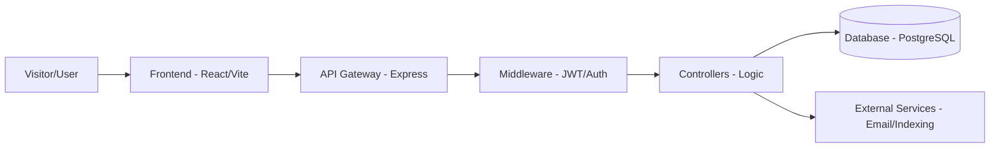

# 🚀 Domain-Dagang: Professional Trading Ecosystem

Platform Penjualan Domain & Jasa Pembuatan Website, dibangun dengan arsitektur modern (Vite/React/Node.js/PostgreSQL).

---

## 📌 Daftar Isi
*   [Fitur Utama](#-fitur-utama)
*   [Alur Sistem](#-alur-sistem)
*   [Tech Stack](#-tech-stack)
*   [Struktur Proyek](#-struktur-proyek)
*   [Quick Start](#-quick-start)
*   [SOP Tim](#-sop-tim)
*   [Seeder & Akun Default](#-seeder--akun-default)

---

## ✨ Fitur Utama
*   **Modern Frontend**: Interface responsif dengan React 19 dan Tailwind CSS 4.
*   **Robust Backend**: API berbasis Express 5 dengan optimasi PostgreSQL.
*   **Secure Auth**: Otentikasi berbasis JWT dan integrasi Google OAuth.
*   **Automated Services**: Pengiriman email (Nodemailer) dan task scheduling (Node-cron).
*   **File Management**: Upload file aman menggunakan Multer.
*   **SEO Optimized**: Arsitektur yang mendukung Server-Driven SEO (Dynamic Meta & Sitemap).

---

## 🔄 Alur Sistem



---

## 🛠 Tech Stack

| Layer | Technology | Version |
| :--- | :--- | :--- |
| **Frontend** | React, Vite, Tailwind CSS | ^19.2, ^7.2, ^4.1 |
| **Routing** | React Router DOM | ^7.13 |
| **Backend** | Express.js, Node.js | ^5.2 |
| **Database** | PostgreSQL (pg), MySQL | ^8.18 |
| **Auth** | JWT, Google OAuth | ^9.0, ^10.5 |
| **Utility** | Axios, SweetAlert2, Recharts | ^1.13, ^11.26, ^3.7 |

---

## 📂 Struktur Proyek

```text
Domain-Dagang/
├── backend/                # API & Business Logic
│   ├── controllers/        # Route Handlers
│   ├── database_pg.sql     # Database Schema
│   ├── index.js           # Server Entry Point
│   ├── middleware/         # Auth & Security
│   ├── routes/             # API Endpoints
│   └── services/           # Business Services
├── src/                    # Frontend Application
│   ├── components/         # Reusable UI
│   ├── pages/              # View Components
│   └── main.jsx            # React Entry Point
├── dist/                   # Production Build
└── docs/                   # System Documentation
```

---

## ⚡ Quick Start

1.  **Clone & Install Dependensi**:
    ```bash
    npm install
    cd backend && npm install
    ```
2.  **Environment Setup**:
    Buat file `.env` di direktori `backend/` mengikuti format `.env.example`.
3.  **Run Development Mode**:
    *   Frontend: `npm run dev`
    *   Backend: `cd backend && npm run dev`

---

## 📝 SOP Tim

> [!IMPORTANT]
> Seluruh pengerjaan wajib mengikuti standar yang ditetapkan di **[.agents/skills/project-sop/SKILL.md](file:///home/domaindagang/Domain-Dagang/.agents/skills/project-sop/SKILL.md)**.

*   **Auto-Documentation**: Setiap fitur baru wajib tercatat di `docs/system-flow.md`.
*   **Security First**: Audit input untuk mencegah SQLi dan XSS pada setiap controller.
*   **SEO Compliance**: Pastikan meta tags dinamis terinjeksi untuk setiap route publik.

---

## 🔑 Seeder & Akun Default

| Role | Email | Password |
| :--- | :--- | :--- |
| **Admin** | `admin@domaindagang.com` | `admin123` |
| **User Demo** | `user@example.com` | `password123` |

---

> [!NOTE]
> Proyek ini dikelola secara profesional oleh Antigravity dengan standar keamanan dan optimasi SEO tingkat tinggi.
